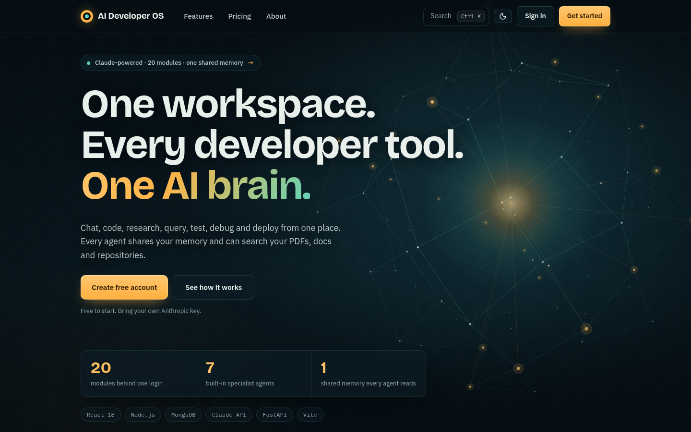
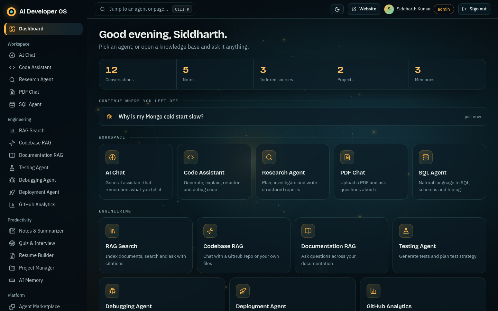
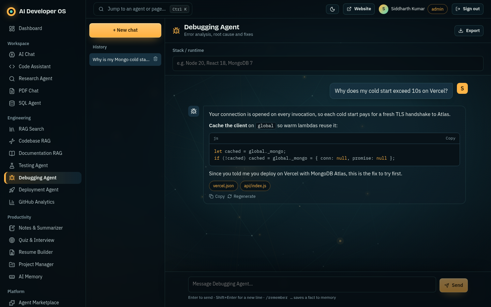
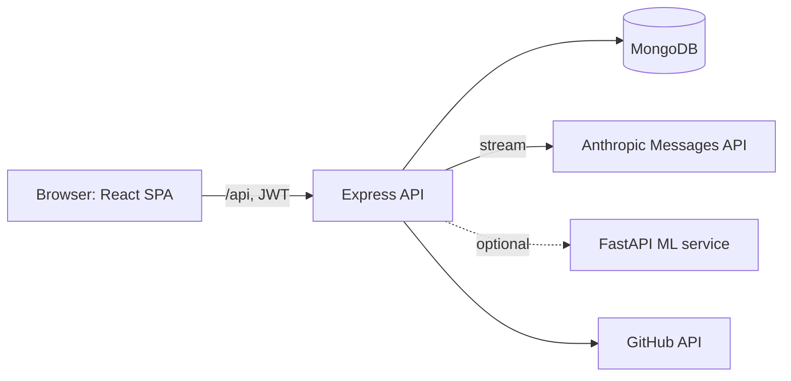

<div align="center">


# AI Developer OS

**One workspace. Every developer tool. One AI brain.**

A full-stack MERN workspace where chat, code, research, SQL, testing, debugging and deployment agents
share one persistent memory, backed by a hybrid RAG engine and an optional Python ML service.

[](.github/workflows/ci.yml)


[Quick start](#quick-start) · [Modules](#modules) · [Architecture](docs/ARCHITECTURE.md) · [API](docs/API.md) · [Deploy](#deploy-on-vercel) · [Security](SECURITY.md)

<br />



</div>

## Highlights

- **One memory, every agent.** Save a fact once and all agents read it before they answer.
- **Answers you can check.** RAG over PDFs, docs and GitHub repos using BM25 plus dense embeddings, with the source passages shown.
- **Twenty modules behind one login.** Chat, code, research, SQL, testing, debugging, deployment, notes, quizzes, resumes, projects and more.
- **Bring your own key or deploy with one.** Users can paste an Anthropic key in Settings, or you can set a server key.
- **Production habits built in.** Strict CSP, rate limits, input validation, per-user quotas, data export and deletion, CI, Docker and Vercel configs.

<table>
  <tr>
    <td></td>
    <td></td>
  </tr>
</table>

<sub>Screenshots use sample data from a mocked API.</sub>

## Modules

| Area         | Modules                                                                                                                 |
| ------------ | ----------------------------------------------------------------------------------------------------------------------- |
| Workspace    | Auth (JWT) · AI Chat · Code Assistant · Research Agent · PDF Chat · SQL Agent                                           |
| Engineering  | RAG Search · Codebase RAG (GitHub import) · Documentation RAG · Testing · Debugging · Deployment · GitHub Analytics     |
| Productivity | Notes & Summarizer (+NLP) · Quiz & Interview Simulator · Resume Builder (+ATS) · Project Manager · Persistent AI Memory |
| Platform     | Agent Marketplace (templates, community, custom agents) · Admin Dashboard · Settings (keys, password, data export)      |

## Quick start

```bash
npm install
cp .env.example .env        # optional: ANTHROPIC_API_KEY (or paste a key in Settings later)
npm run dev                 # API on :5000, web on :5173
```

Open http://localhost:5173 and click **Skip for now** to enter the full workspace (every page, Admin included). With no `MONGODB_URI` the API starts an embedded MongoDB in `.data/` (the first run downloads it once). Or register: **the first real account becomes admin.**

AI replies need an Anthropic key: set `ANTHROPIC_API_KEY` in `.env`, or paste one in **Settings**.

Prefer containers? `JWT_SECRET=$(openssl rand -hex 32) ANTHROPIC_API_KEY=sk-ant-... docker compose up --build` starts MongoDB and the app on :5000. Add `--profile ml` for the ML service.

## Scripts

| Command                       | What it does                                                |
| ----------------------------- | ----------------------------------------------------------- |
| `npm run dev`                 | API and web with hot reload                                 |
| `npm run build` / `npm start` | Production client build / run API and serve the build       |
| `npm test`                    | Server tests (`node:test`) and client tests (Vitest)        |
| `npm run lint` / `format`     | ESLint / Prettier                                           |
| `npm run check`               | Lint, format check, tests and build: the same steps CI runs |

## Architecture at a glance



## Project structure

```
client/                 React 18 + Vite SPA
  public/               favicon, app icons, social image, manifest, robots, sitemap
  src/pages/{site,app}  public website / signed-in workspace (code-split)
  src/components/       ui · layout · chat · site · effects · system
  src/hooks, lib        data hooks, API client, auth, highlighter
  src/styles/           design tokens + one stylesheet per concern
server/
  src/config            env + database
  src/middleware        auth, rate limit, security headers/CORS, request id, errors
  src/models            Mongoose schemas and indexes
  src/services          llm, rag, nlp, ml, purge
  src/routes            one file per resource
  src/data              built-in agents and marketplace templates
  test/                 unit and API tests (no database needed)
api/index.js            Vercel serverless entry
ml-service/             OPTIONAL FastAPI: embeddings + transformer NLP
docs/                   ARCHITECTURE.md, API.md, screenshots
```

See [docs/ARCHITECTURE.md](docs/ARCHITECTURE.md) and [docs/API.md](docs/API.md).

## Deploy on Vercel

1. Create a free **MongoDB Atlas** cluster. Under _Network Access_ allow `0.0.0.0/0` (Vercel IPs are dynamic) and copy the connection string.
2. Push the repo to GitHub and **Import** it in Vercel. `vercel.json` handles build, routing, caching and security headers.
3. Add `MONGODB_URI`, `ANTHROPIC_API_KEY` and **`JWT_SECRET`** (`openssl rand -hex 32`).
4. Deploy, then open `/api/health`: `{"ok":true,"db":true,"llm":true,...}`.
5. Replace `your-domain.example` in `client/public/sitemap.xml` with your real domain.

Limits to know: Vercel request bodies are capped at ~4.5 MB (PDF uploads are limited to 4 MB) and functions at 60 s.

## Security and privacy

bcrypt passwords · 7-day sessions in an httpOnly cookie with CSRF protection, revoked on password change · strict CSP and security headers · closed CORS (`CORS_ORIGIN` to allow others) · per-route input validation and per-user quotas · per-user AI rate limits · usage logs expire after 90 days · self-serve data export and account deletion. Details and known trade-offs: [SECURITY.md](SECURITY.md).

## Environment variables

| Variable                                                          | Required    | Purpose                                                                 |
| ----------------------------------------------------------------- | ----------- | ----------------------------------------------------------------------- |
| `MONGODB_URI`                                                     | yes         | MongoDB connection string                                               |
| `ANTHROPIC_API_KEY`                                               | yes\*       | LLM key (\*or each user pastes one in Settings)                         |
| `JWT_SECRET`                                                      | recommended | Session signing secret; warns at boot if missing in production          |
| `ANTHROPIC_MODEL`                                                 | no          | default `claude-sonnet-5-5`                                             |
| `ENABLE_WEB_SEARCH`                                               | no          | `true` lets the Research Agent use web search                           |
| `GITHUB_TOKEN`                                                    | no          | higher GitHub rate limits / private repo import                         |
| `CORS_ORIGIN`                                                     | no          | comma-separated cross-origin callers (they must use bearer tokens)      |
| `ML_SERVICE_URL`, `ML_SERVICE_KEY`                                | no          | Python ML service                                                       |
| `UPSTASH_REDIS_REST_URL`, `..._TOKEN`                             | no          | shared rate-limit counter across serverless instances                   |
| `ERROR_WEBHOOK_URL`                                               | no          | receives server errors and browser crash reports (Slack, Discord, JSON) |
| `PUBLIC_URL`                                                      | no          | public origin used in billing redirects (default: the request host)     |
| `STRIPE_SECRET_KEY`, `STRIPE_WEBHOOK_SECRET`                      | no          | enable billing                                                          |
| `STRIPE_PRICE_PRO_MONTHLY` (and `_YEARLY`, `STRIPE_PRICE_TEAM_*`) | no          | Stripe price ids for each plan                                          |
| `DEMO_MODE`                                                       | no          | `true` shows a "Try the demo" button that signs in to a sample account  |

## First-time setup helpers

```bash
npm run personalize -- --owner=your-github-user --domain=app.example.com   # fills README badge, canonical URLs, sitemap
npm run seed                                                                # creates demo@ai-developer-os.local with sample data
```

## Optional: billing (Stripe)

Set `STRIPE_SECRET_KEY`, `STRIPE_WEBHOOK_SECRET` and the `STRIPE_PRICE_*` ids, then point a Stripe webhook at `POST /api/billing/webhook` for `checkout.session.completed` and `customer.subscription.updated|deleted`. Settings then shows Upgrade and Manage buttons. The webhook signature is verified. Plans are recorded on the user; **usage quotas are not yet tied to the plan**, and the integration has been tested against mocks only, so try it in Stripe test mode before going live.

## Testing

```bash
npm run check          # lint, format, server + client tests, build
npm run test:coverage  # client coverage
npm run test:e2e       # browser tests incl. axe accessibility checks (needs `npx playwright install chromium` once)
npm run test:integration   # real API + real MongoDB; needs MONGODB_URI_TEST (a throwaway database, it is dropped)
npm run screenshots    # regenerate README screenshots and the landing-page tour (after `npm run build`)
cd ml-service && pip install -r requirements-dev.txt && pytest
```

## Optional: ML service

```bash
cd ml-service && pip install -r requirements.txt && uvicorn main:app --port 8000
```

Deploy it with its `Dockerfile` (Render, Railway, Fly.io, Hugging Face Spaces), set `ML_SERVICE_URL` and `ML_SERVICE_KEY`, then re-index documents so chunks get embeddings. Without it, search uses BM25 and text analysis uses a built-in lexicon.

## Extending

- Add a built-in agent: one entry in `server/src/data/agents.js`, and a route in `client/src/App.jsx` if it needs its own page.
- Swap LLM providers in `server/src/services/llm.js` (`complete` and `stream` are the only functions used).
- Pricing copy lives in `PLANS` in `client/src/lib/site.js`. Real billing is optional: see [Billing](#optional-billing-stripe).

## License

MIT, see [LICENSE](LICENSE). Review the Privacy and Terms pages before a public launch.

## Contributing

Issues and pull requests are welcome. Read [CONTRIBUTING.md](CONTRIBUTING.md) and the [Code of Conduct](CODE_OF_CONDUCT.md) first, and run `npm run check` before you open a PR. Release notes live in [CHANGELOG.md](CHANGELOG.md).
