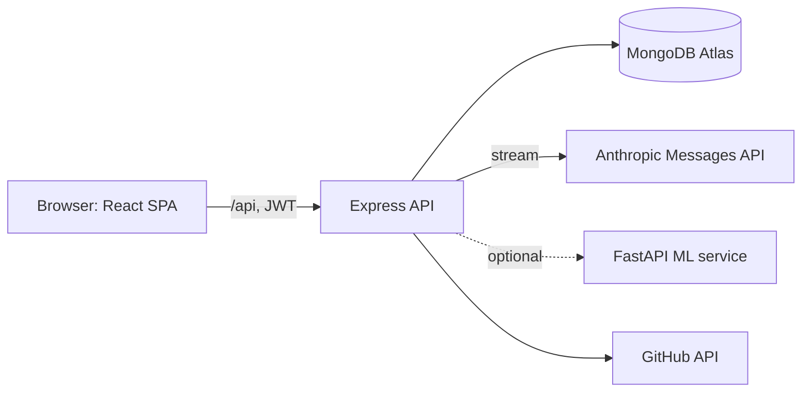

# Architecture

## Request path

`requestContext` (id + access log) → `securityHeaders` + `cors` → JSON body (raw for the Stripe webhook) → CSRF check → global rate limit → database gate → route → `errorHandler` (which reports 5xx to `services/monitor`).

## Server (`server/src`)

| Folder        | Role                                                                                                                                   |
| ------------- | -------------------------------------------------------------------------------------------------------------------------------------- |
| `config/`     | `env.js` (every environment variable, with boot warnings) and `db.js` (cached Mongo connection for serverless)                         |
| `middleware/` | `auth`, `session` (cookies), `csrf`, `rateLimit` (memory or Upstash), `security` (helmet CSP + CORS), `requestContext`, `errorHandler` |
| `models/`     | Mongoose schemas and indexes (`User.js`, `content.js`)                                                                                 |
| `services/`   | `llm` (retries, timeouts, streaming), `rag` (chunking, BM25 + dense retrieval), `nlp`, `ml`, `purge`                                   |
| `routes/`     | One file per resource, mounted in `app.js`                                                                                             |
| `data/`       | Built-in agents and marketplace templates                                                                                              |
| `utils/`      | `http` (async handler, errors) and `validate`                                                                                          |

## Client (`client/src`)

| Folder                                                   | Role                                                                                               |
| -------------------------------------------------------- | -------------------------------------------------------------------------------------------------- |
| `pages/site`, `pages/app`                                | Public website and signed-in workspace (code-split)                                                |
| `components/ui`                                          | Icon, Toast, Dialog, Skeleton                                                                      |
| `components/layout`, `chat`, `site`, `effects`, `system` | Shells, chat/RAG workspaces, marketing sections, 3D background, command palette and error boundary |
| `hooks`, `lib`                                           | Data hooks, API client, auth, syntax highlighter, formatting                                       |
| `styles`                                                 | Tokens and one stylesheet per concern, imported in order by `index.css`                            |

## AI layers

Chat history, persistent memory and retrieved passages are assembled into the system prompt in `routes/chat.js`. Retrieval is BM25, plus cosine similarity over MiniLM embeddings when `ML_SERVICE_URL` is set.
